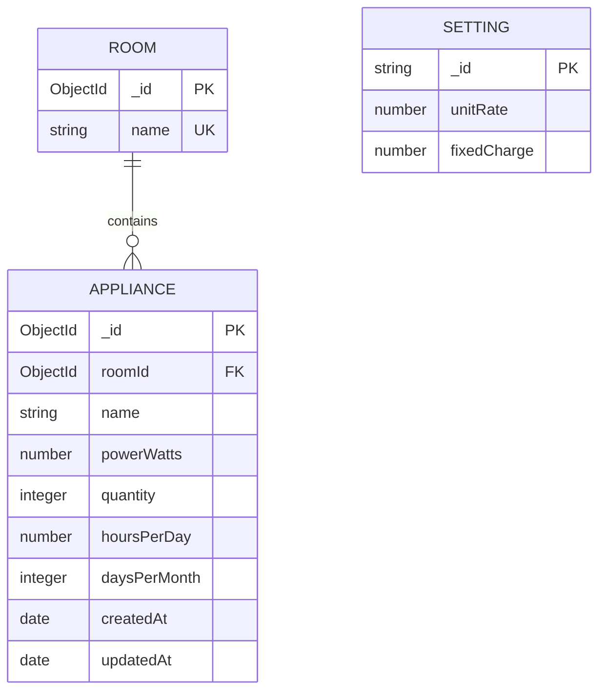

# Database design

The MongoDB database is named `energy_estimator`. Mongoose creates `rooms`, `appliances` and `settings` when the application first writes documents.

## ERD



`integer` describes the validation rule. MongoDB/Mongoose stores these numerical inputs as Number values; JavaScript uses floating-point numbers. `_id` is the unique document key. Settings use a deliberate string key `main`, so there is one global tariff document. Settings apply to the household dataset and do not need a fabricated foreign key.

## Relationships and decisions

One room can contain many appliance records; each appliance references exactly one room through `roomId`. Rooms are predefined: Bedroom, Kitchen, Living Room and Other. Mongoose `populate('roomId', 'name')` includes the room name in API results without duplicating it in every stored appliance document.

MongoDB does not enforce SQL-style foreign keys. The server validates that the referenced room exists. Room editing/deletion is outside this mini project's scope, so normal UI/API actions cannot leave orphaned appliances. The room name has a unique index. Room seeding uses upserts by name and settings seeding uses `_id: main`; restarting does not duplicate rooms or overwrite saved tariff settings. Appliance names need not be unique because separate groups or rooms can contain the same model.

Calculated energy and costs are not stored. Recalculating from the saved inputs prevents stale totals after updates or rate changes. The fixed charge is global and added once, not once per appliance. No user relationship is needed because this is a local single-household application.

## Appliance data dictionary

| Field | Type | Rule |
|---|---|---|
| `_id` | ObjectId | Generated unique primary identifier |
| `name` | String | Trimmed, 2-60 characters |
| `roomId` | ObjectId reference | Required; must identify an existing Room |
| `powerWatts` | Number | Required, 0.1-100,000 W per physical unit |
| `quantity` | Number | Required integer, 1-1,000 |
| `hoursPerDay` | Number | Required, 0-24; decimals allowed |
| `daysPerMonth` | Number | Required integer, 1-31 |
| `createdAt` | Date | Added by Mongoose timestamps |
| `updatedAt` | Date | Updated by Mongoose timestamps |

These broad upper bounds catch accidental entries; this household app is not intended for industrial load modelling.

## Other collections

| Collection | Field | Type/rule |
|---|---|---|
| rooms | `_id` | Generated ObjectId |
| rooms | `name` | Required, trimmed and unique String |
| settings | `_id` | String `main` for the singleton record |
| settings | `unitRate` | Required Number, 0-10,000 LKR/kWh |
| settings | `fixedCharge` | Required Number, 0-1,000,000 LKR/month |

Browser constraints guide input; API type checks reject non-numbers and non-finite values; Mongoose enforces numeric ranges and integer rules on both creation and editing. JSON request fields are explicitly selected, so clients cannot supply arbitrary schema fields or operators.

## Example inputs

An appliance POST request looks like the following. Replace the `roomId` placeholder with an actual `_id` from `/api/rooms`; this example is not a real stored record.

```json
{
  "name": "Ceiling fan",
  "roomId": "REPLACE_WITH_A_ROOM_OBJECT_ID",
  "powerWatts": 75,
  "quantity": 2,
  "hoursPerDay": 8,
  "daysPerMonth": 30
}
```

The settings document initially contains `{"_id":"main","unitRate":30,"fixedCharge":0}`. This rate is illustrative and editable. Mongoose may also include its internal `__v` version field in stored documents/API responses.
